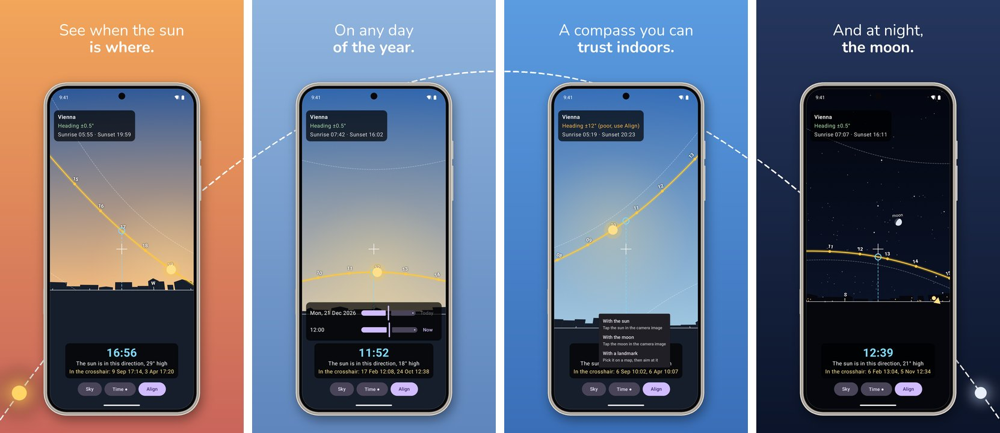
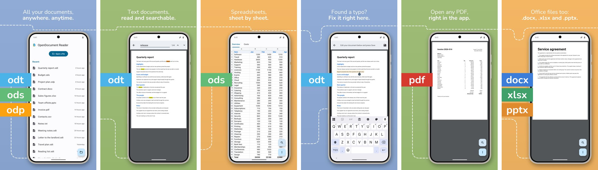
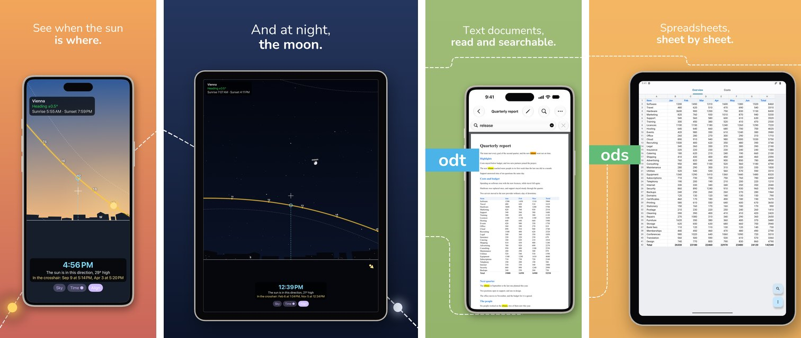
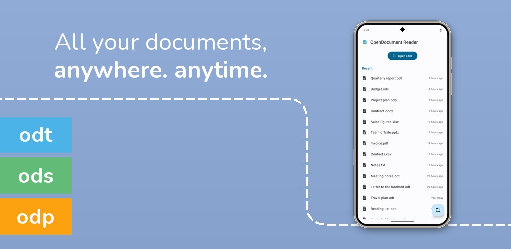

# storeframe

[](https://github.com/andiwand/storeframe/actions/workflows/publish.yml)
[](https://pypi.org/project/storeframe/)
[](https://pypi.org/project/storeframe/)
[](LICENSE)

Turn raw app captures into App Store and Google Play screenshots.

`storeframe` puts each capture inside a **drawn** device (a Pixel, Pixel Tablet,
iPhone or iPad, with no mockup images involved) on a gradient background, sets a
localized two-line headline above it, and can run a decoration across the whole
gallery so the pictures read as one strip when swiped. It works on fastlane's
folder layout, so it slots in between `snapshot`/`screengrab` and `deliver`/`supply`.



It was built for the store listings of
[OpenDocument Reader](https://opendocument.app/) and the
[almucantar](https://github.com/andiwand/almucantar) apps, and replaces the
framing scripts they used to carry.

## Install

```sh
pip install storeframe
# or run it without installing
uvx storeframe devices
pipx run storeframe devices
```

Requires Python 3.10 or newer and Pillow (installed with it).

## Command line

```sh
# a fastlane-style tree: captures/<locale>/*.png -> framed/<locale>/*.png
storeframe frame design.json --platform android --captured fastlane/screenshots --out fastlane/framed
storeframe frame design.json --platform ios     --captured fastlane/screenshots --out fastlane/framed --locale en-US

# also draw Play's 1024x500 feature graphic from the first screen's phone capture
storeframe frame design.json --platform android --captured ... --out ... --feature-graphic

# a single picture
storeframe one design.json capture.png framed.png --screen 01-path --platform ios

storeframe devices          # the devices, platforms and styles there are
```

Each locale folder of the output is emptied first, so a renamed screen never
leaves a stale picture behind for the upload to find. Pass `--locale` (repeatable)
when the capture folder holds anything other than locale folders.

## Styles

**`tabs`**: the device off-centre, coloured tabs running off the left edge, and a
dashed line that crosses every picture. Each picture picks the line up at the
height where the previous one left it.



**`arc`**: a dashed parabola spanning the whole gallery, with the sun rising in the
first picture and the moon up in the last (see the top of this page).

**`plain`**: the device centred, headline above, nothing else.

## Devices and platforms



| Platform | Kind | Device | Output size |
|---|---|---|---|
| `android` | `phone` | `pixel-pro` | 1440×2560 (Play refuses anything longer than 2:1) |
| `android` | `tablet` | `pixel-tablet` | 1600×2560 |
| `ios` | `iphone` | `iphone-pro-max` | the capture's size (the App Store wants the device's) |
| `ios` | `ipad` | `ipad-pro-13` | the capture's size |

A capture named `<kind>-<screen>.png` (`phone-01-path.png`) says which kind it
is. Anything else, such as fastlane snapshot's `iPhone 17 Pro Max-01-path.png`,
is matched to the device with the closest aspect ratio. The screen is the one
whose name (or alias) the file name ends with.

The devices are drawn from their real proportions: bezel width, how much of it is
black glass versus metal, corner shape (near-circular on a Pixel, a continuous
curve on an iPhone), punch hole or Dynamic Island, keys and SIM tray. Every
measure is a fraction of the screen, so a device looks the same at any size.



## The design file

One JSON file per app describes its gallery:

```json
{
  "style": "arc",
  "backgrounds": { "evening": ["#f2a65a", "#c9655b"], "night": ["#25365e", "#0b1429"] },
  "screens": [
    {
      "name": "01-path",
      "background": "evening",
      "headline": { "en-US": ["See when the sun", "is where."], "de-DE": ["Sieh, wann die Sonne", "wo steht."] }
    },
    {
      "name": "04-moon",
      "background": "night",
      "headline": { "en-US": ["And at night,", "the moon."] },
      "aliases": ["04-moon-lite"]
    }
  ]
}
```

| Key | |
|---|---|
| `style` | `plain`, `arc` or `tabs` |
| `backgrounds` | named top/bottom gradient colours; a screen may also give a pair inline |
| `screens` | in store order; `headline` per locale, one string per line (the first line light, the rest bold) |
| `chips` | `tabs` style: tab colours by name at the top level, and a list of tab names on each screen |
| `font`, `weights` | a font file relative to the design, and the named weights per line; the bundled Nunito by default |
| `fallback_locale` | used when a locale has no headline (`de-AT` tries `de` first); `en-US` by default |
| `layouts`, `params` | per-kind overrides (`phone`, `tablet`, `iphone`, `ipad`, `feature`) of where things sit and of the style's numbers |
| `options` | style switches, e.g. `{"moon": false}` for `arc` |

Hindi, Japanese and Chinese headlines are set in a system font: Noto
(`fonts-noto-core`, `fonts-noto-cjk`) on Linux and the system fonts on macOS.
Without one, framing stops with an error instead of drawing empty boxes in place of the text.

## Python

```python
from PIL import Image
import storeframe

design = storeframe.Design.load("design.json")

picture = storeframe.screenshot(
    Image.open("phone-01-path.png"), design, "01-path",
    kind="phone", device="pixel-pro", locale="de-DE", canvas_size=(1440, 2560),
)
picture.save("framed.png")

report = storeframe.frame_directory(design, "ios", "fastlane/screenshots", "fastlane/framed")
```

## Development

```sh
uv venv && uv pip install -e '.[dev]'
.venv/bin/pytest
.venv/bin/ruff check src tests
```

Releases are published to PyPI by GitHub Actions when a GitHub release is
created; the tag has to match `__version__` in `src/storeframe/__init__.py`.

## License

MIT. The bundled Nunito font is under the SIL Open Font License 1.1
(`src/storeframe/fonts/OFL.txt`). The sample pictures show
[Sonnseite](https://github.com/andiwand/almucantar) and
[OpenDocument Reader](https://opendocument.app/).
